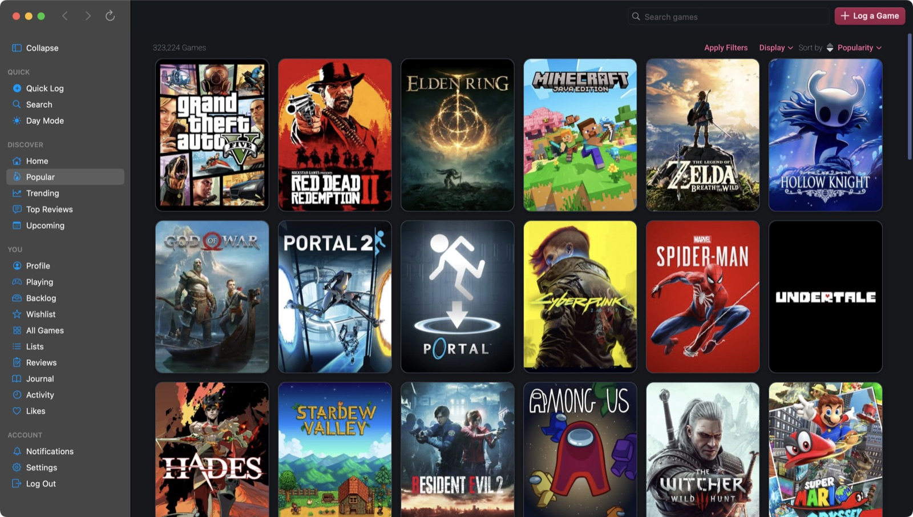
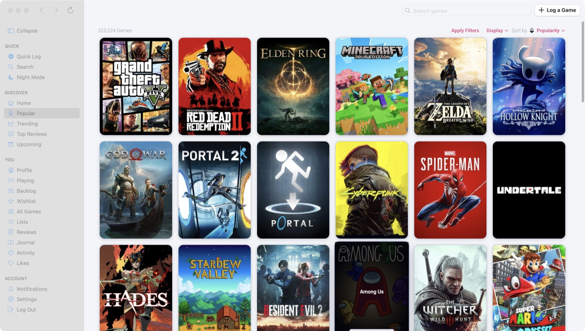
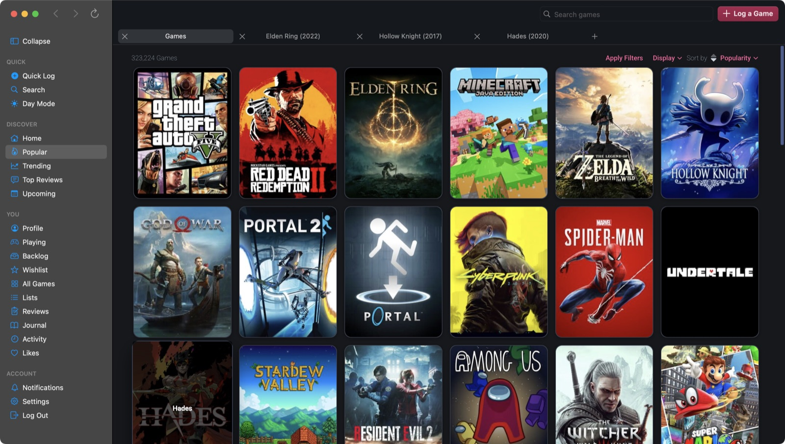
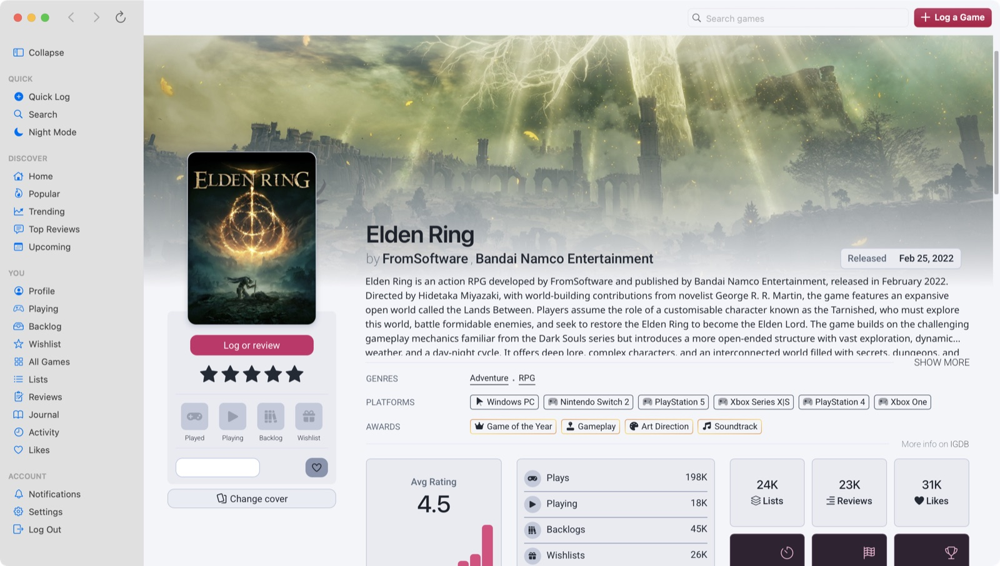
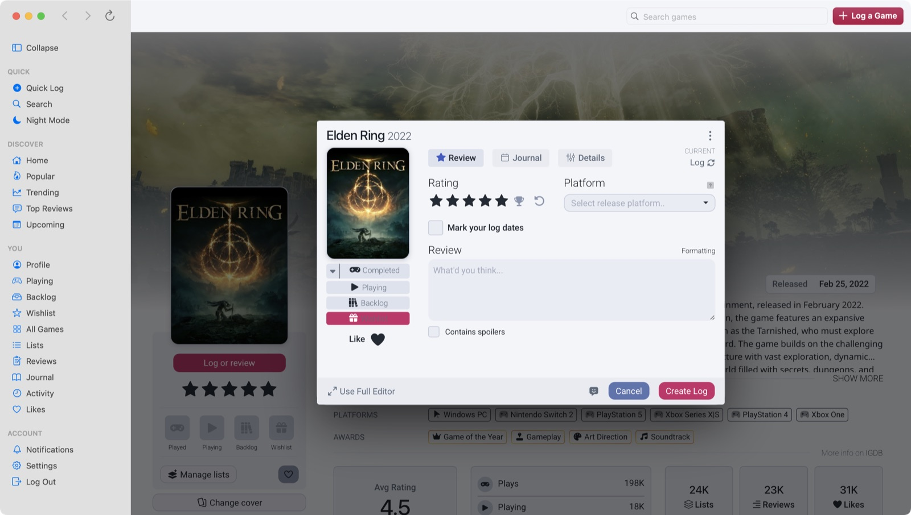

# Backloggd for Mac

A native macOS app for [Backloggd](https://backloggd.com), the video game collection tracker.
It shows the website in its own Mac window, with a sidebar, toolbar, tabs, day/night mode,
notifications and a menu-bar item.

> **Unofficial.** This project is not made by, affiliated with, or endorsed by Backloggd.
> It simply displays backloggd.com inside a macOS window. All content, names and trademarks
> belong to their owners. Please respect Backloggd's [terms of service](https://backloggd.com/terms/).



| Day mode | Tabs |
| --- | --- |
|  |  |

| Game page | Log a game |
| --- | --- |
|  |  |

## Features

- Native sidebar (collapses to an icon rail) and a toolbar with back / forward / reload / search / **Log a Game**
- **Tabs**: ⌘T new, ⌘W close, ⇧⌘T reopen, ⌘-click opens a link in a tab, ⌃Tab or ⌘1–9 to switch. Tabs come back on relaunch
- **Day and night mode**: matches macOS, or switch with ⇧⌘L
- **Quick Log** (⌘L) and **search** (⌘K)
- Menu-bar item and a global hotkey (⌃⌥B) with quick links to Playing, Backlog and Wishlist
- macOS notification and Dock badge when you have unread Backloggd notifications
- A branded loading screen, page transitions, modern look, compact and wide layouts, optional custom CSS (View menu)
- Stays signed in between launches

## Install

1. Go to the [**Releases**](../../releases/latest) page and download `Backloggd-1.0.0.dmg`.
2. Open it and drag **Backloggd** to **Applications**.
3. First launch: macOS may say the app can't be verified, because this build is not notarized by Apple.
   - **macOS 15 and later:** open **System Settings → Privacy & Security**, scroll down and click **Open Anyway**.
   - **macOS 14 and earlier:** right-click the app, choose **Open**, then **Open** again.
   - Or, in Terminal: `xattr -dr com.apple.quarantine /Applications/Backloggd.app`

Requires macOS 12 or newer. Works on Apple Silicon and Intel.

When notifications are on, macOS asks for permission the first time. You can change it later in
**System Settings → Notifications**.

## Build from source

You only need the Xcode command-line tools (`xcode-select --install`).

```sh
zsh build.sh      # universal app in build/Backloggd.app
zsh release.sh    # also creates dist/Backloggd-<version>.dmg and .zip
```

| Path | What it is |
| --- | --- |
| `Sources/main.swift` | the whole app (AppKit + WebKit) |
| `Resources/` | app icon and `Info.plist` template |
| `tools/makeicon.swift`, `tools/banners.swift` | draw the app icon and promo banners |
| `build.sh`, `release.sh` | build and packaging scripts |

## Privacy

The app collects nothing. It only loads backloggd.com, and your login cookies and settings
stay on your Mac. See [PRIVACY.md](PRIVACY.md).

## License

[MIT](LICENSE). The Backloggd name and website are not covered by this license.
